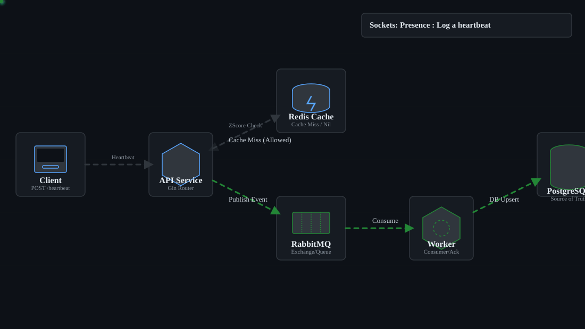
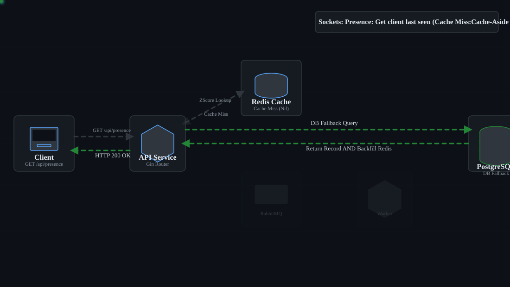

## SEVEN SOCKETS

Instant Messaging Application built with Go. Modular monolith.

Uses Seven ID for Authentication, Authorization and Auditing.

#### The Spring Webflux Implementation of this project was discontinued by me and this was chosen over it due to the several advantages the Golang runtime has against Webflux and the JVM considering High Concurrency, Lightweightness, Memory Consumption and Continuous Streaming. The Webflux project still exists as a learning project.

Uses REST API, RabbitMQ for asynchronous writes and Redis Store for fast reads.

Functionalities to be provided:

* Account authentication with Seven ID: **DONE**
* Account presence/heartbeat persistence: **DONE**
* Account last seen (presence) retrieval: **DONE**
* Sending and receiving of private messages: **IN PROGRESS**
* Sending and receiving of group messages: TODO
* Private calls: TODO
* Group calls: TODO

**PRESENCE PERSISTENCE AND RETRIEVAL**

POST: Log a heartbeat

POST: Log a heartbeat (Deduplication): Make sure all heartbeat POST rerquests made in the last 60 seconds dont flood the db but hit the cache alone

GET: Get client last seen (Cache Hit)

GET: Get client last seen (Cache Miss: DB Fallback with Cache-Aside strategy)

## Requirements

Go version: 1.27.1+

Postgres version: 14+

## Run application

In project root folder
    
    $ docker-compose up -d
    $ go build
    $ ./sockets

Server runs on localhost port 8080